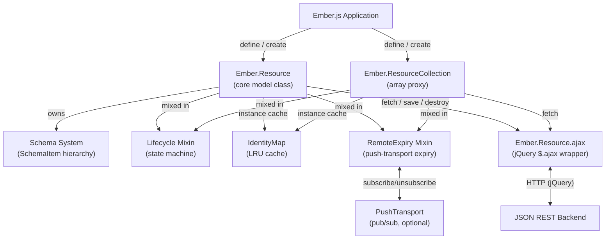

# ember-resource Architecture

## System Overview

ember-resource is a client-side JavaScript library for Ember.js applications that maps JSON REST API responses to typed, observable model objects. It provides schema-defined attributes and associations (has-one, has-many), an LRU-backed identity map for instance deduplication, a resource lifecycle state machine, and jQuery AJAX integration. The build pipeline concatenates multiple source modules into a single browser-compatible script using Broccoli.

## Architecture Diagram



## Component Map

| File | Responsibility | Key Exports |
|------|---------------|-------------|
| `src/base.js` | Bootstraps `Ember.Resource` base class; Ember version compat shims for `getPath`, `sendEvent` | `Ember.Resource` (base) |
| `src/ember-resource.js` | Schema system, lifecycle, CRUD methods, `Ember.ResourceCollection` | All `SchemaItem` types, `Ember.ResourceCollection` |
| `src/identity_map.js` | LRU-backed instance cache keyed by resource ID | `Ember.Resource.IdentityMap` |
| `src/fetch.js` | AJAX wrapper integrating `$.ajax` with `Ember.run` | `Ember.Resource.ajax`, `Em.Resource.fetch` |
| `src/remote_expiry.js` | Mixin for server-push cache invalidation via a configurable transport | `Ember.Resource.RemoteExpiry`, `Ember.Resource.PushTransport` |
| `src/debug_adapter.js` | Ember Inspector integration (DataAdapter) | Registered as `dataAdapter:main` |
| `src/vendor/lru.js` | Vendored LRU cache implementation | `LRUCache` |

### Build Pipeline

Broccoli (`Brocfile.js`) concatenates the files above (in dependency order) into `dist/ember-resource.js`, then minifies to `dist/ember-resource.min.js`. Order: `lru.js → base.js → remote_expiry.js → identity_map.js → fetch.js → ember-resource.js → debug_adapter.js`.

## Schema System

```
AbstractSchemaItem        (base: getValue, setValue, property())
├── SchemaItem            (factory dispatcher — delegates to subtype)
│   └── AttributeSchemaItem       (primitive attributes)
│       ├── NumberAttributeSchemaItem
│       ├── StringAttributeSchemaItem
│       ├── BooleanAttributeSchemaItem
│       └── DateAttributeSchemaItem
├── HasOneSchemaItem      (singular associations)
│   ├── HasOneRemoteSchemaItem    (FK stored in data, lazy-loads by ID)
│   └── HasOneNestedSchemaItem    (object embedded in parent data)
│       └── HasOneNestedIdSchemaItem
└── HasManySchemaItem     (collection associations)
    ├── HasManyRemoteSchemaItem   (separate URL fetch)
    ├── HasManyNestedSchemaItem   (array embedded in parent data)
    └── HasManyInArraySchemaItem  (array of IDs in parent data)
```

Schema items are created by `SchemaItem.create(name, schema)` which dispatches to the correct subclass based on type and flags (`nested`, `url`). Each item implements `getValue`, `setValue`, and `toJSON`.

## Resource Lifecycle

```
INITIALIZING (0) → UNFETCHED (10) → FETCHING (40) → FETCHED (50)
                                 ↓                ↓
                              EXPIRING (20) → EXPIRED (30)
                                               ↓
                                          SAVING (60)
                                               ↓
                                       DESTROYING (70) → DESTROYED (80)
```

State transitions are driven by lifecycle events (`willFetch`, `didFetch`, `didFail`, `willSave`, `didSave`) and an optional background clock. The clock is **not** started by default.

## Request Flow

### Fetching a Resource
1. Caller invokes `resource.fetch()`
2. Lifecycle mixin checks `isFetchable` (UNFETCHED or EXPIRED); skips if not
3. `Ember.Resource.sendEvent(self, 'willFetch')` — sets state to FETCHING
4. `Ember.Resource.ajax(options)` wraps `$.ajax`, wraps callbacks in `Em.run`
5. On success: `updateWithApiData(json)` → `deepMerge` into `data`, fires `didFetch`
6. Deferred promise resolves with `(json, resource)`

### Identity Map Lookup
1. `Resource.create({id: N})` checks `this.identityMap.get(id.toString())`
2. If found, calls `updateWithApiData` on the existing instance and returns it
3. If not found, creates a new instance and inserts it into the LRU cache

## Key Design Decisions

### IIFE / Global Export Pattern
All source files use `(function(exports) { ... }(this))` IIFEs with `exports.Ember` rather than ES modules. This keeps the library consumable as a plain `<script>` tag without a bundler.

### Schema-per-Class, Not Per-Instance
The expanded schema (SchemaItem instances) is stored on the class (`constructor.schema`), not on each instance. This allows `createSchemaProperties` to generate Ember computed properties once per class definition.

### LRU Identity Map
Each resource class has an optional LRU identity map (default limit 500). Deduplication is opt-in via `useIdentityMap: true` on `define()`. This prevents duplicate instances for the same backend record while bounding memory usage.

### Deferred Fetch Coalescing
`deferredFetch` stores the in-flight promise. Subsequent `fetch()` calls while a request is pending return the same promise rather than issuing a duplicate AJAX call.

### RemoteExpiry / PushTransport
The remote expiry system is decoupled from any specific push transport. Applications provide a `PushTransport` object (subscribe/unsubscribe) to enable server-push invalidation. The default is a no-op.

## External Dependencies

| Dependency | Used In | Purpose |
|------------|---------|---------|
| jQuery (`$.ajax`, `$.Deferred`) | `src/fetch.js`, `src/ember-resource.js` | AJAX and promises |
| Ember.js | All source files | Object model, computed properties, run loop |
| LRU cache (`src/vendor/lru.js`) | `src/identity_map.js` | Identity map backing store |
| Mocha + Chai + Sinon | `spec/` (dev only) | Test framework + assertion + XHR stubbing |
| Broccoli + plugins | `Brocfile.js` (dev only) | Build/concatenation/minification |

See `package.json` for exact dev dependency versions.
